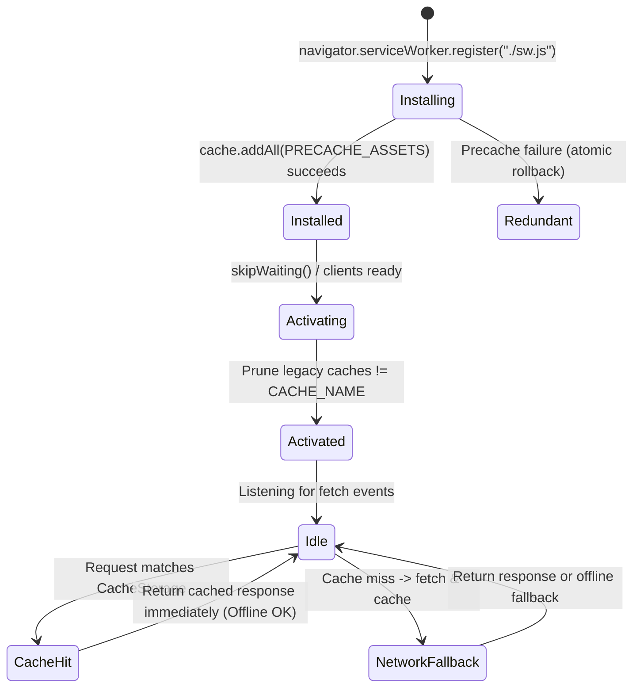
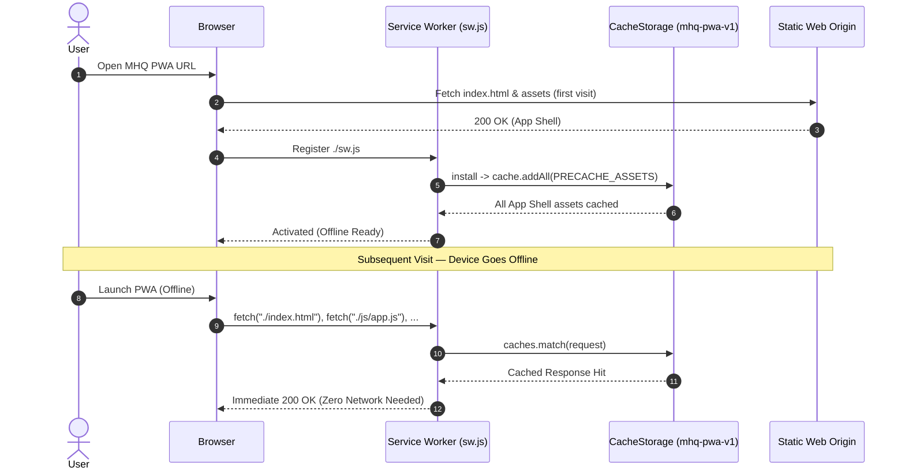
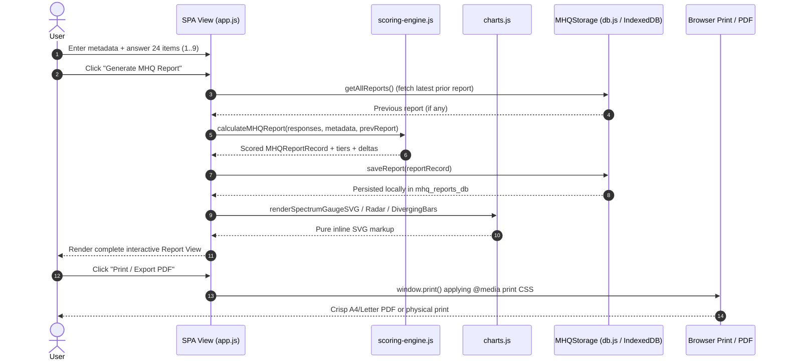

# Software Development Life Cycle (SDLC)
## Mental Health Quotient (MHQ) Report Generation Progressive Web Application (Offline-First)

**Document Version:** 1.0.0  
**Related Specification:** [Software Requirements Specification (`SRS.md`)](./SRS.md)  
**License:** MIT License (see [`LICENSE`](../LICENSE))  

---

## 1. SDLC Model & Justification

### 1.1 Selected Methodology: Iterative, Privacy-By-Design, Offline-First Agile SDLC
Because this application handles sensitive personal mental-wellbeing reflections while guaranteeing **100% offline execution**, a classical server-centric waterfall or continuous cloud-deployment pipeline is unsuitable. Instead, the project adopts an **Iterative, Privacy-By-Design, Offline-First Agile SDLC** structured around six tightly governed phases with explicit privacy, psychometric accuracy, and offline-availability gates at every iteration.

### 1.2 Why This Model Fits MHQ PWA
1. **Privacy-By-Design Gatekeeping:** Every design increment is verified for zero external telemetry, zero backend transmission, and local-only IndexedDB persistence.
2. **Offline-First Determinism:** Service Worker caching (`sw.js`) and zero-CDN asset bundling are treated as Day-1 architectural invariants, not post-hoc performance add-ons.
3. **Psychometric Auditability:** Isolating domain data (`js/mhq-data.js`) and scoring math (`js/scoring-engine.js`) into pure ES modules enables rapid clinical/domain review and automated Node.js boundary verification (`tests/verify.mjs`) without headless browser overhead.

---

## 2. Detailed SDLC Phases

### Phase 1: Requirements Engineering & Domain Modeling
- **Objectives:** Establish precise functional/non-functional contracts ([`SRS.md`](./SRS.md)), define the 6 MHQ wellbeing dimensions, calibrate the asymmetric `-100` to `+200` scoring scale, and perform privacy threat modeling.
- **Activities:**
  - Define 6 core dimensions (`mood_outlook`, `social_self`, `drive_motivation`, `cognition`, `adaptability_resilience`, `mind_body`) and 24 items anchored on a 1–9 scale.
  - Specify piecewise linear transformation anchored at `4 -> 0` so negative distress (`[-100, 0)`) and positive flourishing (`[0, +200]`) preserve clinical interpretability.
  - Author standardized tier cutoffs (`Clinical`, `Struggling`, `Enduring`, `Managing`, `Succeeding`, `Thriving`) and non-diagnostic disclaimer requirements.
- **Exit Gate:** Approved `SRS.md` with complete Requirements Traceability Matrix (RTM).

### Phase 2: System & Offline-First Architecture Design
- **Objectives:** Design the zero-dependency App Shell, Service Worker cache lifecycle, IndexedDB schema, and pure SVG charting architecture.
- **Key Architectural Decisions:**
  - **Zero-Dependency Vanilla ES Modules:** Eliminates third-party CDN failures offline and avoids supply-chain vulnerabilities.
  - **App Shell Precache Model:** All HTML, CSS, JS modules, manifest, and SVG icons are precached atomically during Service Worker `install`.
  - **IndexedDB Primary + Resilient Fallback:** `mhq_reports_db` (`v1`) with `reports` object store (`keyPath: "id"`, `createdAt` index), backed by `localStorage` and in-memory `Map` fallbacks for restricted browser contexts.
  - **Vector SVG Charts + CSS `@media print`:** Ensures reports render sharply on screens and convert cleanly to A4/Letter PDFs offline without server-side PDF rendering.

### Phase 3: Modular Implementation
- **Objectives:** Implement cleanly separated, single-responsibility ES modules and accessible UI templates.
- **Module Boundaries:**
  - `js/mhq-data.js` — Immutable domain constants: dimensions, 24 items, tiers, evidence-informed recommendations, and 3 sample profiles (`thriving`, `managing`, `struggling`).
  - `js/scoring-engine.js` — Pure deterministic math functions: `scoreItemToMHQ`, `getTierForScore`, and `calculateMHQReport`.
  - `js/charts.js` — Pure SVG string renderers: `renderSpectrumGaugeSVG`, `renderRadarChartSVG`, `renderDivergingBarsSVG`, `renderHistoryTrendSVG`.
  - `js/db.js` — `MHQStorage` persistence abstraction over IndexedDB, `localStorage`, and memory fallback.
  - `js/app.js` — SPA controller: view routing, questionnaire state, report generation, history management, online/offline events, PWA install prompt, and Service Worker registration.
  - `index.html` & `css/styles.css` — Accessible semantic UI shell, design tokens, and `@media print` pagination rules.
  - `sw.js` & `manifest.webmanifest` — Offline Cache-First Service Worker and standalone PWA manifest.
- **Coding Standards:** Strict ES2022 modules, explicit JSDoc documentation, HTML escaping for all user-provided inputs (XSS defense), and zero external network URLs.

### Phase 4: Multi-Tier Testing & Verification Strategy
- **Objectives:** Verify mathematical exactness, SVG output validity, offline asset completeness, and print fidelity before release.
- **Verification Tiers:**
  1. **Automated Unit & Contract Verification (`node tests/verify.mjs`):**
     - Validates `LICENSE` (MIT), `docs/SRS.md`, `docs/SDLC.md`, `README.md`, and all PWA asset files exist and are non-empty.
     - Asserts exact mathematical anchors for `scoreItemToMHQ`: `1 -> -100`, `2.5 -> -50`, `4 -> 0`, `6.5 -> +100`, `9 -> +200`.
     - Executes `calculateMHQReport` across `thriving`, `managing`, and `struggling` presets, verifying tier assignment, strengths/priority areas, and longitudinal delta math.
     - Validates all four `charts.js` SVG functions output well-formed `<svg>...</svg>` markup containing expected labels and score indicators.
     - Parses `manifest.webmanifest` JSON and verifies every asset path listed in `sw.js` `PRECACHE_ASSETS` exists on disk.
     - Verifies zero external `http://` or `https://` script/stylesheet dependencies inside `index.html` or `css/styles.css`.
  2. **Manual / Browser Offline & Print Verification:**
     - Serve over local HTTP (`python -m http.server 8080`), verify Service Worker enters `activated` state, toggle DevTools **Offline** mode, reload page cold, complete an assessment, save to IndexedDB, and verify Print/Save as PDF output.

### Phase 5: Deployment, PWA Distribution & Cache Versioning
- **Objectives:** Publish static artifacts cleanly while guaranteeing deterministic client cache updates and zero wasted CI runner minutes.
- **Local Build & Deployment Checklist:**
  - Run `node scripts/build-local.mjs --sync-gh-pages` locally to execute syntax checks, the 9-test verification suite (including the `< 100ms` NFR-03 rendering budget), and clean static asset packaging onto the `gh-pages` branch (excluding `.github`, `tests`, and `scripts`).
  - Push `gh-pages` so GitHub's native static `pages-build-deployment` deploys directly without spawning redundant multi-branch Ubuntu CI runner workflows.
  - Host static repository root on any HTTPS static host (GitHub Pages, Netlify, Cloudflare Pages, Nginx, or local intranet server).
  - Verify `manifest.webmanifest` is served with `application/manifest+json` (or valid JSON) and `sw.js` at scope root `./`.
  - **Cache Versioning Protocol:** Every release modifying HTML, CSS, or JS modules MUST increment `CACHE_NAME` in `sw.js` (e.g., `mhq-pwa-v1` -> `mhq-pwa-v2`). On `activate`, the Service Worker automatically deletes prior cache buckets so users never run mismatched module versions.

### Phase 6: Maintenance, Longitudinal Schema Migration & Continuous Improvement
- **Objectives:** Evolve questionnaire norms, visualizations, and storage schemas without breaking historical user reports stored offline.
- **IndexedDB Migration Protocol (`onupgradeneeded`):**
  - Increment `DB_VERSION` in `js/db.js` when adding stores or indexes.
  - Preserve backward compatibility with `schemaVersion: 1` `MHQReportRecord` objects via additive defaults during read/comparison rather than destructive overwrites.
- **Psychometric Updates:** Changes to item wording or tier boundaries require incrementing `schemaVersion` and annotating historical report records so longitudinal delta comparisons clearly disclose methodology revisions.

---

## 3. Architecture & Sequence Diagrams

### 3.1 Service Worker Registration & Cache-First Fetch Flow

### 3.2 End-to-End Assessment, Scoring, SVG Rendering, IndexedDB Storage & PDF Export

---

## 4. Risk Register & Mitigation Matrix

| Risk ID | Risk Description | Likelihood | Impact | Mitigation Strategy |
| :--- | :--- | :---: | :---: | :--- |
| **R-01** | **Clinical Misinterpretation:** Users mistake wellness MHQ scores for a formal medical diagnosis. | Medium | High | Embed explicit non-diagnostic disclaimer on UI & PDF reports; display crisis support guidance when scores fall in `Clinical` or `Struggling` bands. |
| **R-02** | **Shared-Device Privacy Exposure:** Another person opens the browser on a shared machine and reads saved IndexedDB reports. | Medium | High | Store optional non-identifying aliases; provide 1-click **Delete** per record and **Clear All Local History** purge controls in History view. |
| **R-03** | **Stale Service Worker Cache:** Users remain stuck on outdated JS/CSS after an application update. | Medium | Medium | Enforce semantic `CACHE_NAME` versioning (`mhq-pwa-v1`), `skipWaiting()`, `clients.claim()`, and atomic deletion of obsolete caches during `activate`. |
| **R-04** | **IndexedDB Unavailable / Restricted:** Private browsing or enterprise policies block `window.indexedDB`. | Low | Medium | Implement transparent fallback chain in `js/db.js`: IndexedDB -> `localStorage` -> in-memory `Map` with clear UI indicator. |
| **R-05** | **Browser Print / PDF Clipping:** Charts split across pages or colors vanish in default browser print settings. | Medium | Medium | Use inline vector SVGs (`viewBox` scaled), `break-inside: avoid`, explicit `@media print` rules, and `print-color-adjust: exact`. |
| **R-06** | **Offline Cold-Start Asset Failure:** External CDN links (fonts, icon packs, chart libs) fail when offline. | High (if used) | High | Strict Zero-CDN policy: all CSS, JS modules, and SVG icons reside locally and are verified against `sw.js` `PRECACHE_ASSETS`. |

---

## 5. Definition of Done (DoD) & Release Readiness Checklist

Before any release tag is created, all items below MUST pass:

- [x] **Licensing:** Root `LICENSE` (MIT) is present and referenced in documentation and `README.md`.
- [x] **Documentation:** `docs/SRS.md` and `docs/SDLC.md` reflect the exact implemented formulas, dimensions, storage schemas, and file paths.
- [ ] **Deterministic Scoring Verified:** `node tests/verify.mjs` confirms boundary values (`-100`, `-50`, `0`, `+100`, `+200`) and sample profiles (`thriving`, `managing`, `struggling`).
- [ ] **Offline Completeness Verified:** Every entry in `sw.js` `PRECACHE_ASSETS` exists on disk, `manifest.webmanifest` parses cleanly, and zero external HTTP/HTTPS asset dependencies exist.
- [ ] **Security & XSS Hygiene:** All user-supplied text (participant alias, notes) is HTML-escaped prior to DOM insertion.
- [ ] **Print / PDF Readiness:** `@media print` hides interactive controls and preserves SVG vector charts cleanly.
