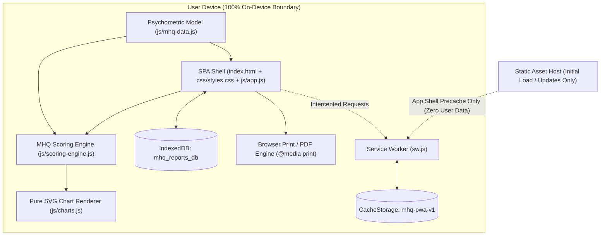

# Software Requirements Specification (SRS)
## Mental Health Quotient (MHQ) Report Generation Progressive Web Application (Offline-First)

**Document Version:** 1.0.0  
**Standard Alignment:** IEEE Std 830-1998 / ISO/IEC/IEEE 29148:2018  
**License:** MIT License (see [`LICENSE`](../LICENSE))  
**Repository:** `mhq-reports`  

---

## 1. Introduction

### 1.1 Purpose
This Software Requirements Specification (SRS) defines the functional, non-functional, mathematical, interface, and offline-first architectural requirements for the **Mental Health Quotient (MHQ) Report Generation Progressive Web Application (PWA)**. It establishes an authoritative engineering contract for developers, QA engineers, privacy auditors, and clinical/wellness stakeholders building or extending the system.

### 1.2 Document Conventions
- **Requirement Identifiers:** Functional requirements are tagged `FR-01` through `FR-07`; non-functional requirements are tagged `NFR-01` through `NFR-05`.
- **Priority Levels:** `MUST` / `SHALL` denote mandatory requirements; `SHOULD` denotes strongly recommended capabilities; `MAY` denotes optional enhancements.
- **Scale Notation:** Interval notation `[a, b)` means inclusive of `a` and exclusive of `b`; `[a, b]` means inclusive of both endpoints.

### 1.3 Intended Audience
- **Software Engineers & Architects:** Implementing client-side ES modules, SVG visualization renderers, IndexedDB storage layers, and Service Worker caching.
- **QA & Verification Engineers:** Writing deterministic scoring tests, offline execution audits, and print/PDF layout checks.
- **Clinicians, Counselors & Wellness Facilitators:** Reviewing psychometric dimension definitions, asymmetric spectrum thresholds, and report disclaimers.
- **Privacy & Security Reviewers:** Auditing zero-network data isolation and on-device data persistence.

### 1.4 Product Scope
The MHQ Report Generation PWA is a **100% client-side, zero-dependency, offline-first web application** that captures structured multi-dimensional mental wellbeing responses, transforms ratings onto the standardized **-100 to +200 MHQ spectrum**, renders publication-grade **inline SVG analytical charts**, supports **longitudinal history tracking via IndexedDB**, and produces **formatted A4/Letter printable and PDF-exportable clinical-style reports**—all without transmitting any user or assessment data over the network.

> **Clinical Disclaimer Scope:** The application is designed for structured self-reflection, wellness benchmarking, and supportive practitioner-assisted discussions. It is **not** a medical diagnostic device and does not replace professional psychiatric evaluation or emergency intervention.

### 1.5 Open-Source Licensing
This software and its accompanying documentation are distributed under the **MIT License** ([`LICENSE`](../LICENSE)). Users, organizations, and researchers may freely use, copy, modify, merge, publish, distribute, sublicense, and deploy the software with attribution and without warranty.

### 1.6 Definitions, Acronyms, and Abbreviations
| Term / Acronym | Definition |
| :--- | :--- |
| **MHQ** | **Mental Health Quotient** — A composite psychometric metric spanning an asymmetric spectrum from `-100` (clinical distress/impairment) through `0` (functional baseline) to `+200` (optimal thriving). |
| **PWA** | **Progressive Web Application** — A standards-based web application installable to desktop or mobile devices via a Web App Manifest and capable of offline operation via a Service Worker. |
| **Service Worker (`sw.js`)** | A programmable browser background proxy thread intercepting HTTP requests to serve precached App Shell assets offline. |
| **Cache-First Strategy** | A caching pattern where the Service Worker checks `CacheStorage` first and returns cached assets immediately, falling back to the network only on cache miss. |
| **IndexedDB** | A transactional, asynchronous client-side NoSQL object store built into modern web browsers for durable offline persistence. |
| **App Shell** | The minimal HTML, CSS, JavaScript ES modules, manifest, and vector icons required to boot the UI completely offline. |
| **Spectrum Tiers** | Six standardized score bands across `[-100, +200]`: *Clinical*, *Struggling*, *Enduring*, *Managing*, *Succeeding*, and *Thriving*. |
| **RTM** | Requirements Traceability Matrix. |

---

## 2. Overall Description

### 2.1 Product Perspective
The system operates as a standalone, self-contained **Single-Page Progressive Web Application (SPA)** served over HTTPS (or `localhost` during development). After the initial page load and Service Worker installation, the application operates completely independently of any backend server, REST API, authentication service, or external CDN.



### 2.2 Product Functions
1. **Participant Metadata & Session Intake:** Captures optional non-identifying alias, age bracket, assessment date, session notes, and provides 1-click sample preset profiles (*Thriving*, *Managing*, *Struggling*).
2. **6-Dimension MHQ Assessment:** Administers 24 structured items (4 items per dimension) rated on a 1–9 spectrum anchored at functional baseline (`4`).
3. **Deterministic Asymmetric Scoring:** Computes individual dimension MHQ scores, composite overall MHQ score, tier classifications, top strengths, priority growth areas, and longitudinal deltas.
4. **Visual Report Generation:** Produces interactive/print-ready vector SVG visualizations (Spectrum Gauge, 6-Axis Radar Chart, Diverging Bar Chart, Historical Trend Chart) alongside structured dimension insight cards and actionable guidance.
5. **Printable / PDF Export:** Formats the report for A4/Letter paper or Save-as-PDF via dedicated `@media print` rules with preserved vector graphics and controlled page breaks.
6. **Local Longitudinal Persistence:** Saves, retrieves, compares, and deletes report records in IndexedDB (with resilient `localStorage`/in-memory fallback).
7. **Offline-First PWA Shell:** Installs natively as a standalone app, displays real-time Online/Offline status, and renders 100% offline.

### 2.3 User Classes and Characteristics
| User Class | Description | Technical / Domain Proficiency | Primary Goals |
| :--- | :--- | :--- | :--- |
| **Self-Assessor** | Individual evaluating personal mental wellbeing privately on a personal device. | Low to moderate technical skill; non-clinical. | Complete assessment quickly offline, understand strengths/gaps visually, save progress locally, optionally export PDF. |
| **Clinician / Counselor** | Mental health practitioner conducting intake or periodic wellbeing reviews with clients. | Moderate technical skill; high domain proficiency. | Generate repeatable baseline and follow-up MHQ reports, compare deltas over time, print clean clinical-style summaries. |
| **Wellness Researcher / Educator** | Educator or researcher demonstrating MHQ methodology or evaluating preset profiles. | High domain/technical proficiency. | Test preset profiles (*Thriving*, *Managing*, *Struggling*), inspect deterministic scoring formulas, audit offline data sovereignty. |

### 2.4 Operating Environment
- **Client Browsers:** Modern evergreen browsers supporting ES2022 Modules, Service Workers, CacheStorage, IndexedDB, SVG 1.1, and CSS Grid/Print (`Chrome >= 100`, `Edge >= 100`, `Firefox >= 105`, `Safari >= 16`).
- **Hosting Requirement:** Any static file server over `HTTPS` (production) or `http://localhost` (local development) to satisfy Secure Context requirements for Service Workers.
- **Verification Runtime:** Node.js `>= 20` (for running automated ESM verification suite `tests/verify.mjs`).
- **External Dependencies:** **None.** Zero npm runtime packages and zero remote CDN stylesheets, scripts, or fonts.

### 2.5 Design and Implementation Constraints
- **C-01 Zero-CDN Policy:** Every script, stylesheet, icon, and chart MUST be bundled locally so cold offline launches never fail on blocked or missing external network calls.
- **C-02 Zero-Telemetry Privacy:** The application MUST NOT emit analytics beacons, cookies, crash telemetry, or assessment payloads to external hosts.
- **C-03 Pure Vector Visualization:** Charts MUST be generated directly as inline SVG DOM strings without canvas rasterization or third-party charting libraries, ensuring crisp rendering across high-DPI displays and PDF exports.

### 2.6 Assumptions and Dependencies
- Users have JavaScript enabled and browser storage (IndexedDB or `localStorage`) permitted for the application origin.
- Printing to PDF relies on the host browser/OS native print-to-PDF subsystem triggered via `window.print()`.

---

## 3. System Features & Functional Requirements

### 3.1 Assessment Session & Metadata Intake (`FR-01`)
- **FR-01.1:** The system SHALL provide an intake metadata form accepting:
  - Participant Alias / Identifier (text, optional, defaults to `"Anonymous Participant"` if omitted).
  - Age Group (selection: `"18–24"`, `"25–34"`, `"35–44"`, `"45–54"`, `"55–64"`, `"65+"`, or `"Prefer not to say"`).
  - Assessment Date (ISO `YYYY-MM-DD`, defaulting to the current local date).
  - Context / Clinical Notes (optional multi-line text included on the generated report).
- **FR-01.2:** The system SHALL provide 1-click **Sample Profile Presets** (`Thriving`, `Managing`, `Struggling`) that populate all 24 questionnaire items and metadata for immediate demonstration or verification.
- **FR-01.3:** The system SHALL provide a **Reset Assessment** action clearing current responses without altering previously saved IndexedDB history.

### 3.2 Six-Dimension MHQ Questionnaire (`FR-02`)
- **FR-02.1:** The questionnaire SHALL evaluate **six (6) mental wellbeing dimensions**, each represented by **four (4) items** (24 items total):
  1. **Mood & Outlook (`mood_outlook`):** Emotional valence, optimism, frustration tolerance, and sadness/worry regulation.
  2. **Social Self (`social_self`):** Interpersonal connection, empathy, social confidence, and relationship satisfaction.
  3. **Drive & Motivation (`drive_motivation`):** Purposefulness, goal initiation, persistence, and reward engagement.
  4. **Cognition (`cognition`):** Focus, working memory, decision clarity, and cognitive flexibility.
  5. **Adaptability & Resilience (`adaptability_resilience`):** Stress recovery, emotional regulation under uncertainty, and behavioral adaptability.
  6. **Mind-Body Connection (`mind_body`):** Sleep restoration, somatic energy, physical tension awareness, and mind-body balance.
- **FR-02.2:** Each item SHALL be rated on an integer **1–9 spectrum scale**:
  - `1` = Severe Distress / Frequent Impairment (`-100`)
  - `2` = Marked Difficulty (`-67`)
  - `3` = Mild Strain (`-33`)
  - `4` = Functional Baseline (`0` — neutral threshold)
  - `5` = Stable (`+40`)
  - `6` = Positive (`+80`)
  - `7` = Strong (`+120`)
  - `8` = Very Strong (`+160`)
  - `9` = Optimal / Thriving (`+200`)
- **FR-02.3:** The UI SHALL display a live completion progress counter (`X / 24 items answered`) and prevent report generation until all 24 items have valid ratings in `[1, 9]`, highlighting the first unanswered item if submission is attempted incomplete.

### 3.3 Asymmetric MHQ Scoring Engine (`FR-03`)
- **FR-03.1:** Each item rating $r \in [1, 9]$ SHALL be mapped deterministically onto the asymmetric `[-100, +200]` MHQ spectrum anchored at $r = 4 \mapsto 0$ (see Section 6.1).
- **FR-03.2:** Each dimension score SHALL equal the arithmetic mean of its 4 item MHQ scores, rounded to the nearest integer and clamped within `[-100, +200]`.
- **FR-03.3:** The composite overall MHQ score SHALL equal the arithmetic mean of the 6 dimension MHQ scores, rounded to the nearest integer and clamped within `[-100, +200]`.
- **FR-03.4:** Both overall and per-dimension scores SHALL be classified into one of six standardized MHQ Spectrum Tiers:

| Tier ID | Label | Score Range | Clinical / Functional Interpretation |
| :--- | :--- | :--- | :--- |
| `clinical` | **Clinical** | `[-100, -50)` | Significant distress or functional impairment; professional clinical support strongly recommended. |
| `struggling` | **Struggling** | `[-50, 0)` | Notable strain eroding daily comfort or resilience; targeted intervention and support advised. |
| `enduring` | **Enduring** | `[0, 50)` | Baseline coping with limited psychological reserve; vulnerable under acute stressors. |
| `managing` | **Managing** | `[50, 100)` | Stable everyday functioning with clear opportunities to strengthen flourishing. |
| `succeeding` | **Succeeding** | `[100, 150)` | High positive wellbeing, strong cognitive-emotional reserve, and adaptive engagement. |
| `thriving` | **Thriving** | `[150, 200]` | Peak mental flourishing, deep resilience, and sustained multi-domain vitality. |

- **FR-03.5:** The engine SHALL identify the **top 2 strength dimensions** (highest scores), **top 2 priority focus dimensions** (lowest scores), an executive narrative summary, and tailored dimension-level evidence-informed recommendations conditioned on score band (`negative: < 0`, `moderate: 0..99`, `high: >= 100`).
- **FR-03.6:** When a prior saved report exists, the engine SHALL compute longitudinal score deltas ($\Delta_{\text{overall}}$ and per-dimension $\Delta_d$).

### 3.4 Analytical Report Generation & Visual Charts (`FR-04`)
- **FR-04.1:** The report view SHALL display an Executive Summary header showing participant metadata, report ID, generation timestamp, overall MHQ score badge, tier classification, and longitudinal delta badge (when applicable).
- **FR-04.2:** The report view SHALL render four pure vector inline SVG visualizations:
  1. **Overall MHQ Spectrum Gauge (`renderSpectrumGaugeSVG`):** Segmented `-100` to `+200` horizontal scale with tier bands, `0` threshold marker, and score pointer callout.
  2. **6-Dimension Radar Chart (`renderRadarChartSVG`):** Hexagonal spider plot displaying the participant's 6-dimension profile polygon against concentric `-100`, `0` (functional baseline ring), `+100`, and `+200` reference rings.
  3. **Dimension Diverging Bar Chart (`renderDivergingBarsSVG`):** Horizontal diverging bars anchored at `0`, extending left in warning coral/amber for negative scores (`[-100, 0)`) and right in teal/emerald for positive scores (`[0, +200]`).
  4. **Longitudinal History Trend Chart (`renderHistoryTrendSVG`):** Chronological SVG polyline trend chart across saved assessments in the History view.
- **FR-04.3:** The report view SHALL include a 6-card Dimension Deep-Dive grid presenting each dimension's score, tier pill, percentile-normalized progress indicator, description, and specific actionable guidance.
- **FR-04.4:** Every report SHALL prominently display a non-diagnostic wellness disclaimer and supportive crisis guidance notice if overall or dimension scores fall into the *Clinical* or *Struggling* bands.

### 3.5 Printable / PDF-Exportable Report Engine (`FR-05`)
- **FR-05.1:** The Report View SHALL provide a **Print / Export PDF** button invoking `window.print()`.
- **FR-05.2:** Stylesheets SHALL define `@media print` rules that:
  - Hide interactive navigation bars, form controls, toast messages, and action toolbars.
  - Force exact background color and SVG fill preservation (`print-color-adjust: exact; -webkit-print-color-adjust: exact`).
  - Prevent page breaks inside charts, executive summary cards, and dimension cards (`break-inside: avoid`).
  - Display a clean print-only clinical report header and timestamp footer.

### 3.6 Local IndexedDB Persistence & Longitudinal History (`FR-06`)
- **FR-06.1:** The application SHALL automatically save generated reports (or allow explicit save/update) into IndexedDB database `mhq_reports_db` (object store `reports`, `keyPath: "id"`, `createdAt` index).
- **FR-06.2:** If IndexedDB is blocked or unsupported (e.g., private browsing edge cases), the storage layer SHALL seamlessly fall back to `localStorage` or an in-memory `Map` while surfacing storage mode status.
- **FR-06.3:** The **History View** SHALL list all locally saved reports sorted newest-first, display the Longitudinal Trend SVG chart when `>= 2` reports exist, and allow the user to:
  - Re-open any historical report in full detail.
  - Delete an individual report.
  - Purge all local data via a confirmed **Clear All Local History** control.

### 3.7 Offline-First PWA Capabilities (`FR-07`)
- **FR-07.1:** The application SHALL include a valid `manifest.webmanifest` declaring `name`, `short_name`, `start_url`, `display: "standalone"`, `theme_color`, `background_color`, and SVG app icons (`192x192` and `512x512`).
- **FR-07.2:** On startup, `js/app.js` SHALL register `./sw.js`, which precaches the entire App Shell during `install`, cleans obsolete caches during `activate`, and serves requests using a **Cache-First** strategy during `fetch`.
- **FR-07.3:** The header SHALL display a live network connectivity indicator (`Online — Offline Ready` / `Offline Mode Active`) responding to `online` and `offline` browser events.
- **FR-07.4:** When the browser emits `beforeinstallprompt`, the UI SHALL reveal an **Install App** button allowing one-click PWA installation.

---

## 4. External Interface Requirements

### 4.1 User Interfaces
- **Single-Page Tabbed Workspace:**
  1. **Assessment Tab:** Metadata intake, preset selector, progress bar, 6 grouped dimension sections with accessible radio/button rating scales (1–9), and Generate Report CTA.
  2. **Report Tab:** Executive header, Spectrum Gauge, Radar + Diverging Charts, Strengths & Priority Areas, 6 Dimension Insight Cards, Print/PDF action.
  3. **History Tab:** Storage status summary, Longitudinal SVG Trend chart, saved assessments table, Clear All Data button.
  4. **SRS & SDLC Info Tab:** Built-in architectural overview, scoring formula reference, and privacy guarantees accessible even offline.

### 4.2 Hardware & Print Interfaces
- Responsive CSS layout adapting seamlessly across mobile (`>= 320px`), tablet (`>= 768px`), and desktop (`>= 1024px`) viewports.
- Print output targeting standard A4 (`210mm × 297mm`) and US Letter (`8.5in × 11in`) media with `12mm` margins.

### 4.3 Browser Software APIs
- `navigator.serviceWorker` & `CacheStorage` API for offline App Shell caching.
- `window.indexedDB` for structured client-side report storage.
- `window.print()` for PDF generation and physical printing.
- `window.navigator.onLine` + `online`/`offline` events for connectivity telemetry.

---

## 5. Non-Functional Requirements (NFRs)

| ID | Category | Requirement Specification | Target Metric / Verification |
| :--- | :--- | :--- | :--- |
| **NFR-01** | **Offline Availability** | After first load, 100% of assessment, scoring, SVG rendering, IndexedDB persistence, and print workflows SHALL operate with zero network connectivity. | 0 failed network requests; 100% App Shell cached in `sw.js`. |
| **NFR-02** | **Privacy & Sovereignty** | No assessment answers, notes, aliases, or generated reports SHALL ever leave the user's browser or be sent to any server. | Zero external `fetch`/`XHR`/beacon calls in application code. |
| **NFR-03** | **Performance** | Report calculation and inline SVG rendering SHALL complete without perceptible UI lag. | `< 100ms` total scoring + DOM render latency on standard hardware. |
| **NFR-04** | **Accessibility** | Interactive controls SHALL support keyboard navigation, focus rings, semantic `<label>`/`aria-label` attributes, and WCAG 2.1 AA color contrast (`>= 4.5:1` for text). | Semantic HTML5 landmarks + ARIA roles on custom/SVG elements. |
| **NFR-05** | **Print/PDF Fidelity** | Vector charts and tier badges SHALL retain crisp typography, colors, and intact card boundaries when printed or saved as PDF. | Explicit `@media print` styling verified via CSS rules. |
| **NFR-06** | **Maintainability** | Codebase SHALL use modular ES2022 files with zero build-step lock-in and deterministic unit-testable pure functions for scoring and SVG generation. | Direct execution in Node.js ESM test suite (`tests/verify.mjs`). |

---

## 6. Mathematical Scoring Model & Data Schemas

### 6.1 Piecewise Linear MHQ Mapping Formula
Given raw item rating $r \in [1, 9]$ where $r = 4$ is anchored to the functional zero threshold ($0$):

$$
\text{MHQ}(r) =
\begin{cases}
\dfrac{r - 4}{3} \times 100, & \text{if } 1 \le r < 4 \\[10pt]
\dfrac{r - 4}{5} \times 200, & \text{if } 4 \le r \le 9
\end{cases}
$$

**Anchor Verification Points:**
- $r = 1.0 \implies \frac{-3}{3} \times 100 = -100$
- $r = 2.5 \implies \frac{-1.5}{3} \times 100 = -50$
- $r = 4.0 \implies \frac{0}{5} \times 200 = 0$
- $r = 6.5 \implies \frac{2.5}{5} \times 200 = +100$
- $r = 9.0 \implies \frac{5}{5} \times 200 = +200$

**Dimension Score ($D_k$) and Composite Overall MHQ Score ($M$):**

$$
D_k = \text{round}\left(\frac{1}{4} \sum_{i=1}^{4} \text{MHQ}(r_{k,i})\right), \quad M = \text{round}\left(\frac{1}{6} \sum_{k=1}^{6} D_k\right)
$$

### 6.2 `MHQReportRecord` JSON Schema (IndexedDB `reports` Object Store)
```json
{
  "id": "mhq-20261118-a1b2c3",
  "schemaVersion": 1,
  "createdAt": "2026-11-18T05:40:00.000Z",
  "metadata": {
    "participantAlias": "Alex Rivera",
    "ageGroup": "25-34",
    "assessmentDate": "2026-11-18",
    "notes": "Quarterly baseline check-in",
    "profilePreset": null
  },
  "responses": {
    "mood_1": 6,
    "mood_2": 7
  },
  "overallScore": 86,
  "overallTier": {
    "id": "managing",
    "label": "Managing",
    "min": 50,
    "max": 100
  },
  "dimensions": [
    {
      "id": "mood_outlook",
      "title": "Mood & Outlook",
      "score": 90,
      "tier": { "id": "managing", "label": "Managing" },
      "normalizedPercent": 63,
      "recommendation": "..."
    }
  ],
  "strengths": ["cognition", "social_self"],
  "priorityAreas": ["mind_body", "adaptability_resilience"],
  "deltaFromPrevious": {
    "previousReportId": "mhq-20261015-x9y8z7",
    "previousDate": "2026-10-15",
    "overallDelta": 12,
    "dimensionDeltas": { "mood_outlook": 15 }
  }
}
```

---

## 7. Requirements Traceability Matrix (RTM)

| Req ID | Requirement Summary | Implementing Module(s) | Verification Method |
| :--- | :--- | :--- | :--- |
| `FR-01` | Intake metadata, 1-click sample presets, reset | `index.html`, `js/mhq-data.js`, `js/app.js` | Unit check on `SAMPLE_PROFILES` + UI form validation |
| `FR-02` | 6 dimensions × 4 items on 1–9 spectrum | `js/mhq-data.js`, `js/app.js` | Automated check verifying 6 dimensions & 24 items (`verify.mjs`) |
| `FR-03` | Asymmetric `[-100, +200]` scoring, 6 tiers, deltas | `js/scoring-engine.js` | Boundary & profile assertions in `tests/verify.mjs` |
| `FR-04` | Spectrum Gauge, Radar, Diverging Bars, Trend SVGs | `js/charts.js`, `js/app.js` | SVG DOM integrity & axis/score checks in `tests/verify.mjs` |
| `FR-05` | Print / PDF export formatting (`@media print`) | `css/styles.css`, `js/app.js` | CSS `@media print` inspection + `window.print()` integration |
| `FR-06` | IndexedDB CRUD persistence + storage fallback | `js/db.js`, `js/app.js` | `MHQStorage` fallback & store schema checks |
| `FR-07` | Service Worker Cache-First, Manifest, Online/Offline UI | `sw.js`, `manifest.webmanifest`, `js/app.js` | Manifest JSON schema + `sw.js` precache file existence check |
| `NFR-01` | 100% offline availability (zero remote CDNs) | `index.html`, `sw.js`, `css/styles.css` | Asset precache & zero external URL check in `tests/verify.mjs` |
| `NFR-02` | Zero network transmission of user data | `js/app.js`, `js/db.js`, `js/scoring-engine.js` | Static inspection confirming no remote API uploads |
| `NFR-03` | `< 100ms` deterministic report & SVG generation | `js/scoring-engine.js`, `js/charts.js` | Execution timing check in `tests/verify.mjs` |
| `NFR-04` | WCAG 2.1 AA contrast & semantic ARIA | `index.html`, `css/styles.css`, `js/charts.js` | Semantic markup, `role="img"`, and contrast tokens |
| `NFR-05` | Crisp print/PDF vector graphics & page breaks | `css/styles.css`, `js/charts.js` | `@media print` rules & inline SVG preservation |
